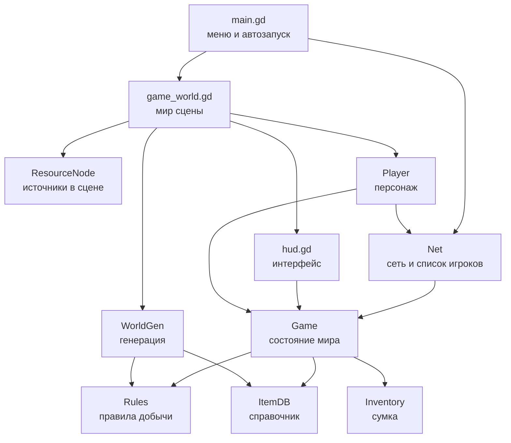
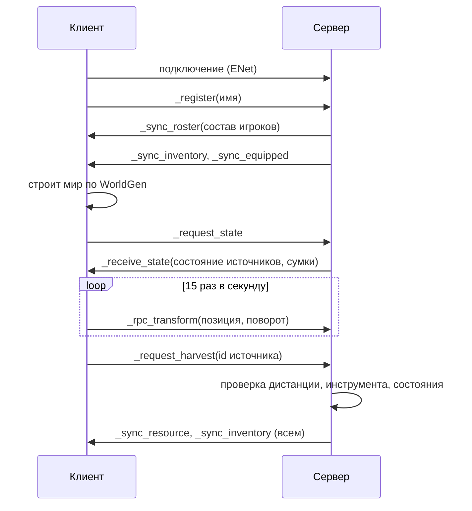

# Архитектура

## Принцип

Ядро отдельно, модули отдельно. Ядро это чистые данные и правила: справочник
предметов, сумка, правила добычи, генерация мира. У ядра нет ни сцен, ни сети,
поэтому его можно прогнать тестом в headless-режиме. Модули (сеть, мир,
персонаж, интерфейс) знают про ядро, ядро про них не знает.

## Слой за слоем



## Четыре автозагрузки

| Имя | Файл | Ответственность |
| --- | --- | --- |
| Controls | scripts/core/controls.gd | карта управления, поднимается кодом |
| Net | scripts/net/net.gd | ENet, состав игроков, обмен позициями |
| Game | scripts/core/game.gd | авторитетное состояние мира и инвентарей |
| Features | scripts/core/features.gd | флаги механик и сборка механик |

Порядок автозагрузки важен: Controls, Net, Game, Features. Net не знает про
ресурсы, Game не знает про сокеты, Features не знает ни про то, ни про другое:
она только читает features.cfg и создаёт узлы механик под миром.

## Механики

Механика это отдельная папка в `scripts/mechanics/<имя>/` и один узел,
который Features создаёт под миром. Три правила механики: свои узлы строит
сама, своё состояние держит сама, своё состояние сама гоняет по сети.

Контракт в `scripts/core/mechanic.gd`:

| Метод | Когда вызывается | Что делает |
| --- | --- | --- |
| id() | всегда | имя механики, оно же имя узла |
| setup(world) | до add_child | строит узлы, читает данные |
| start() | после add_child | подключает сигналы, просит состояние у сервера |
| stop() | перед удалением | снимает сигналы |

Имя узла совпадает с id, поэтому RPC внутри механики сходятся на сервере и на
клиенте без ручной регистрации путей.

```mermaid
graph TD
    W[game_world.gd<br/>мир] --> F[Features<br/>attach_mechanics]
    F --> M1[stats<br/>характеристики и здоровье]
    F --> M2[crafting<br/>рецепты и сумка]
    F -.->|флаг false| X[не создаётся]
    H[hud.gd] -->|Features.mechanic("stats")| M1
    P[player.gd] -->|Features.mechanic("stats")| M1
```

Связь с остальным миром только через `Features.mechanic(id)` с проверкой на
null. Поэтому выключенная или удалённая механика никого не ломает: HUD
показывает прочерки, персонаж идёт с базовой скоростью, окно статуса не
создаётся.

Что нужно, чтобы добавить механику:

1. Папку `scripts/mechanics/<имя>/` со скриптом, который `extends Mechanic`.
2. Строку в `Features.MECHANICS` (id и путь).
3. Флаг в `FeatureFlags.DEFAULTS` и в `features.cfg`.

Что нужно, чтобы выключить: `false` в features.cfg. Чтобы убрать совсем:
удалить папку и строку реестра. Ядро править не надо.

Порядок в реестре важен. Статистика стоит раньше мобов: мобы наносят урон
через `stats.damage(...)`, и к моменту их создания статистика уже есть.

## Мобы

Механика `mobs` (scripts/mechanics/mobs/) держит три вида: кабан, слайм, паук.
Узлы мобов строятся у всех из `WorldGen.mob_spawns()`, поэтому точки появления
совпадают без трафика. Поведение считает только сервер, клиент плавно догоняет
последнюю присланную позицию (15 раз в секунду, unreliable_ordered).

Состояние одного моба на сервере:

```
{
  "type": "boar" | "slime" | "spider",
  "home": Vector3,        # своё место, к нему кабан возвращается
  "position": Vector3,
  "hp": float, "alive": bool, "respawn_left": float,
  "mode": "calm" | "flee" | "idle" | "leap" | "attached" | "pause" | "dead",
  "timer": float,         # остаток режима: бег, прыжок, стойка
  "target": int,          # ближайший игрок, 0 если никого
  "attached_to": int,     # на кого прилип слайм
  "attack_left": float, "web_left": float
}
```

Урон в обе стороны идёт через характеристики. Игрок бьёт: клиент выбирает моба
перед собой, сервер проверяет расстояние (4.2 плюс запас 1.0 метра) и темп
(0.35 с), считает урон как `удар × удар / (удар + тело моба)`, где удар это
сила персонажа, умноженная на силу оружия в руке (`ItemDB.attack_multiplier`).
Моб бьёт через `stats.damage(peer_id, attack, kind)`, поэтому без механики
характеристик он просто не ранит.

Позиция персонажа клиентская, поэтому толчок кабана и паутину паука сервер
только решает применить, а исполняет клиент-владелец: `_receive_push` и
`_receive_slow` приходят всем, но срабатывают только у нужного игрока.

Мобы устроены так же, как остальные механики: папка, строка в реестре, флаг
`mobs`. Нет флага, нет узлов, нет RPC, остальной мир не замечает.

## Сумка и крафт

Сумка остаётся словарём `{item_id: количество}`, по сети едет он же. Сетка это
представление: `Inventory.slots()` отдаёт занятые ячейки в стабильном порядке,
окно дорисовывает пустые до `Inventory.MIN_SLOTS`. Так данные остались простыми,
а сумка выглядит сумкой.

Механика `crafting` (scripts/mechanics/crafting/):

- `recipes.gd` (`Recipes`) это данные: имя, результат, цена, время. Плюс чистые
  проверки `can_craft`, `missing`, `cost_text`, которые работают и со сумкой, и
  со словарём.
- `crafting_mechanic.gd` держит очередь работ: `peer_id -> {recipe, left, total}`.
  Сервер проверяет материалы и место под результат, списывает цену сразу,
  запускает таймер, по готовности кладёт предмет через `Game.give_item`.
  Если места не хватило, возвращает материалы.
- `craft_panel.gd` это вкладка в окне сумки. HUD загружает её по пути, как и
  окно статуса: нет файла или флаг выключен, вкладки нет.

Материалы списываются в начале, поэтому повторный клик не делает второй предмет
из того же набора. Состояние работы уходит клиенту двумя сообщениями
(`_sync_craft`): старт с рецептом и конец с пустым рецептом. Считать остаток на
клиенте не нужно, окно просто показывает «В работе: Копьё».

## Наезд машины

Машину ведёт клиент, поэтому сервер не может спросить у неё скорость. Он считает
её сам: `Game.note_vehicle_transform` запоминает прошлое положение и время,
делит путь на время и сглаживает половиной шага. Сглаживание нужно потому, что
пакеты приходят неровно: без него урон дёргался бы.

Правила в `RamRules` (scripts/world/ram_rules.gd): порог 3 м/с, сила удара это
скорость × 2.5, урон проходит через тело моба той же формулой, что и кулак,
отброс растёт со скоростью. Механика мобов раз в кадр смотрит машины с водителем
и мобов в радиусе 2.8 метра, с откатом 0.6 с на моба. Моб получает `knock_left`,
`knock_dir` и `knock_speed`: пока длится отброс, обычное поведение не считается.
Слайма наезд сбивает с лица, кабана переводит в бег.

## Почему мир генерируется локально

`WorldGen.build()` работает на одном сиде и не использует ничего, кроме
математики, поэтому у сервера и у клиента получается одна и та же карта:
81 источник, одинаковые позиции, одинаковые идентификаторы. По сети едет
только состояние источников (сколько ударов осталось, жив ли, когда
возродится), а не геометрия. Это экономит трафик и убирает целый класс
расхождений.

Проверяется тестом: две генерации подряд дают одинаковый список.

## Поток данных



## Контракты состояния

Состояние источника, ключ в `Game.resources` это номер из генератора:

```
{
  "type": "tree" | "stone" | "ore",
  "hits": int,          # сколько ударов осталось
  "alive": bool,        # можно ли добывать
  "respawn_at": float,  # секунды от старта процесса, 0 если источник жив
  "position": Vector3   # нужна серверу для проверки дистанции
}
```

Сумка по сети едет словарём `{"wood": 3, "axe": 1}` и на приёмной стороне
превращается в `Inventory` через `Inventory.from_dict`.

Предмет описан в `ItemDB.ITEMS`: имя, вид (tool, weapon или material), тег
инструмента, множитель силы удара у оружия, предел стака, цвет для интерфейса.
В руку берётся всё, что `is_equippable`: инструменты и оружие.

Правило добычи описано в `Rules.RESOURCE_SPECS`: нужный инструмент, какой
предмет падает, сколько ударов, время возрождения.

## Контракт характеристик

Состояние одного игрока в механике stats:

```
{
  "attributes": {"strength": 12, "body": 14, "magic": 10, "agility": 19},
  "hp": 78.0,
  "mp": 72.0,
  "downed": false
}
```

Правила взяты из калькулятора манкинов. Здоровье = (тело + сила) × 3, запас сил
= (тело + магия) × 3, скорость = ловкость км/ч, действий за раунд =
ловкость / 10. Производные значения по сети не едут: обе стороны считают их
сами из `DerivedStats`, формулы одни и те же.

Урон приходит в механику как сила удара: `stats.damage(peer_id, 12.0)`. Тело
цели режет его по формуле удар × удар / (удар + тело), поэтому отдельного слоя
брони нет, защита это стат. Считается по эффективному телу, то есть раненый
защищается хуже.

Состояние это C = корень из (доля HP × доля MP). На C умножаются все четыре
характеристики, поэтому раненый бьёт слабее, бежит медленнее и хуже держит
удар. Так в калькуляторе, здесь без самодеятельности.

Сервер меняет состояние и рассылает его, клиент только показывает и просит:
`request_mana` под заклинания, `request_revive` после падения. Списывать запас
сил себе клиент не может, потолок одного запроса ограничен `MAX_MANA_REQUEST`.

Перегруз проверяется раз в секунду: стат выше тела × 5 ранит носителя на 20%
излишка. Упавший игрок остаётся на ногах как объект: здоровье ноль, клиент сам
уводит тело в лагерь и просит подъём.

## Зоны

`WorldGen.zone_at(position)` возвращает имя зоны. Порядок проверок важен:
сначала шахта (внутри радиуса горы), потом каменоломня (кольцо вокруг горы),
потом лес, потом лагерь, иначе поляна. Зона не влияет на правила, это
подсказка игроку.

## Где границы

- Позиция персонажа: авторитет у клиента, сервер только слушает и проверяет
  дистанцию при добыче. Для честной игры в будущем позицию надо считать на
  сервере, это записано в ROADMAP.
- Добыча, сумка, руки: авторитет у сервера. Клиент не может начислить себе
  предмет, он может только попросить.
- Мир: общий код генерации на обеих сторонах, состояние источников с сервера.

## Сцены

`scenes/main.tscn` это один узел со скриптом, `scenes/world.tscn` тоже.
Мир, персонаж и интерфейс собираются кодом из примитивов. Так проект не
зависит от импортированных моделей и одинаково работает на чистой машине.
Когда появятся настоящие модели и анимации, персонажа и источники стоит
перевести в обычные сцены с ресурсами.
