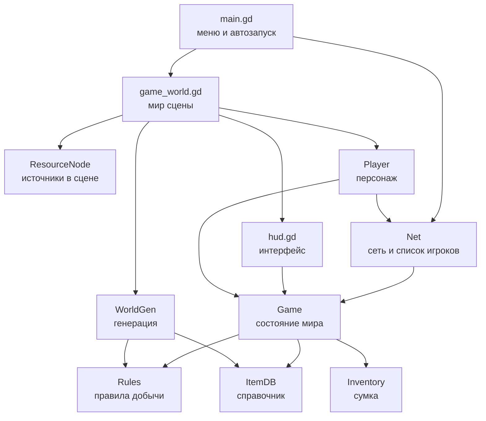
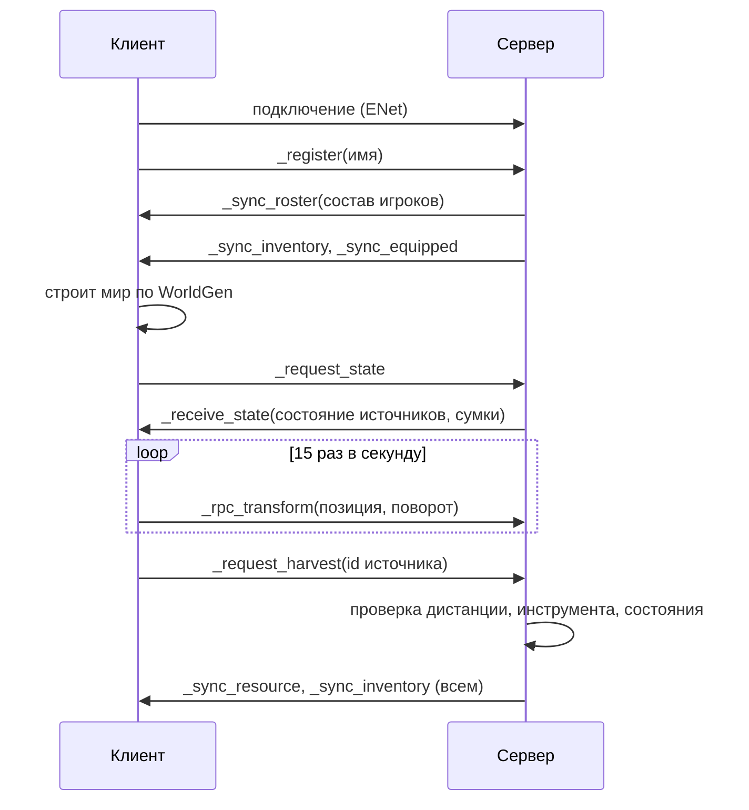

# Архитектура

## Принцип

Ядро отдельно, модули отдельно. Ядро это чистые данные и правила: справочник
предметов, сумка, правила добычи, генерация мира. У ядра нет ни сцен, ни сети,
поэтому его можно прогнать тестом в headless-режиме. Модули (сеть, мир,
персонаж, интерфейс) знают про ядро, ядро про них не знает.

## Слой за слоем



## Четыре автозагрузки

| Имя | Файл | Ответственность |
| --- | --- | --- |
| Controls | scripts/core/controls.gd | карта управления, поднимается кодом |
| Net | scripts/net/net.gd | ENet, состав игроков, обмен позициями |
| Game | scripts/core/game.gd | авторитетное состояние мира и инвентарей |
| Features | scripts/core/features.gd | флаги механик и сборка механик |

Порядок автозагрузки важен: Controls, Net, Game, Features. Net не знает про
ресурсы, Game не знает про сокеты, Features не знает ни про то, ни про другое:
она только читает features.cfg и создаёт узлы механик под миром.

## Механики

Механика это отдельная папка в `scripts/mechanics/<имя>/` и один узел,
который Features создаёт под миром. Три правила механики: свои узлы строит
сама, своё состояние держит сама, своё состояние сама гоняет по сети.

Контракт в `scripts/core/mechanic.gd`:

| Метод | Когда вызывается | Что делает |
| --- | --- | --- |
| id() | всегда | имя механики, оно же имя узла |
| setup(world) | до add_child | строит узлы, читает данные |
| start() | после add_child | подключает сигналы, просит состояние у сервера |
| stop() | перед удалением | снимает сигналы |

Имя узла совпадает с id, поэтому RPC внутри механики сходятся на сервере и на
клиенте без ручной регистрации путей.

```mermaid
graph TD
    W[game_world.gd<br/>мир] --> F[Features<br/>attach_mechanics]
    F --> M1[stats<br/>характеристики и здоровье]
    F -.->|флаг false| X[не создаётся]
    H[hud.gd] -->|Features.mechanic("stats")| M1
    P[player.gd] -->|Features.mechanic("stats")| M1
```

Связь с остальным миром только через `Features.mechanic(id)` с проверкой на
null. Поэтому выключенная или удалённая механика никого не ломает: HUD
показывает прочерки, персонаж идёт с базовой скоростью, окно статуса не
создаётся.

Что нужно, чтобы добавить механику:

1. Папку `scripts/mechanics/<имя>/` со скриптом, который `extends Mechanic`.
2. Строку в `Features.MECHANICS` (id и путь).
3. Флаг в `FeatureFlags.DEFAULTS` и в `features.cfg`.

Что нужно, чтобы выключить: `false` в features.cfg. Чтобы убрать совсем:
удалить папку и строку реестра. Ядро править не надо.

Порядок в реестре важен. Статистика стоит раньше мобов: мобы наносят урон
через `stats.damage(...)`, и к моменту их создания статистика уже есть.

## Почему мир генерируется локально

`WorldGen.build()` работает на одном сиде и не использует ничего, кроме
математики, поэтому у сервера и у клиента получается одна и та же карта:
81 источник, одинаковые позиции, одинаковые идентификаторы. По сети едет
только состояние источников (сколько ударов осталось, жив ли, когда
возродится), а не геометрия. Это экономит трафик и убирает целый класс
расхождений.

Проверяется тестом: две генерации подряд дают одинаковый список.

## Поток данных



## Контракты состояния

Состояние источника, ключ в `Game.resources` это номер из генератора:

```
{
  "type": "tree" | "stone" | "ore",
  "hits": int,          # сколько ударов осталось
  "alive": bool,        # можно ли добывать
  "respawn_at": float,  # секунды от старта процесса, 0 если источник жив
  "position": Vector3   # нужна серверу для проверки дистанции
}
```

Сумка по сети едет словарём `{"wood": 3, "axe": 1}` и на приёмной стороне
превращается в `Inventory` через `Inventory.from_dict`.

Предмет описан в `ItemDB.ITEMS`: имя, вид (tool или material), тег
инструмента, предел стака, цвет для интерфейса.

Правило добычи описано в `Rules.RESOURCE_SPECS`: нужный инструмент, какой
предмет падает, сколько ударов, время возрождения.

## Контракт характеристик

Состояние одного игрока в механике stats:

```
{
  "attributes": {"strength": 4, "body": 4, "magic": 2, "agility": 3},
  "hp": 146.0,
  "mp": 76.0,
  "downed": false
}
```

Производные значения (максимумы, урон, сопротивления, уклонение) по сети не
едут: их обе стороны считают сами из `DerivedStats`, формулы одни и те же.
Сервер меняет состояние и рассылает его, клиент только показывает и просит:
`request_mana` на бег, `request_revive` после падения. Списывать запас сил
себе клиент не может, потолок одного запроса ограничен `MAX_MANA_REQUEST`.

Упавший игрок остаётся на ногах как объект: здоровье ноль, клиент сам уводит
тело в лагерь и просит подъём. Позиция персонажа и так клиентская, поэтому
серверу не нужно её переставлять.

## Зоны

`WorldGen.zone_at(position)` возвращает имя зоны. Порядок проверок важен:
сначала шахта (внутри радиуса горы), потом каменоломня (кольцо вокруг горы),
потом лес, потом лагерь, иначе поляна. Зона не влияет на правила, это
подсказка игроку.

## Где границы

- Позиция персонажа: авторитет у клиента, сервер только слушает и проверяет
  дистанцию при добыче. Для честной игры в будущем позицию надо считать на
  сервере, это записано в ROADMAP.
- Добыча, сумка, руки: авторитет у сервера. Клиент не может начислить себе
  предмет, он может только попросить.
- Мир: общий код генерации на обеих сторонах, состояние источников с сервера.

## Сцены

`scenes/main.tscn` это один узел со скриптом, `scenes/world.tscn` тоже.
Мир, персонаж и интерфейс собираются кодом из примитивов. Так проект не
зависит от импортированных моделей и одинаково работает на чистой машине.
Когда появятся настоящие модели и анимации, персонажа и источники стоит
перевести в обычные сцены с ресурсами.
