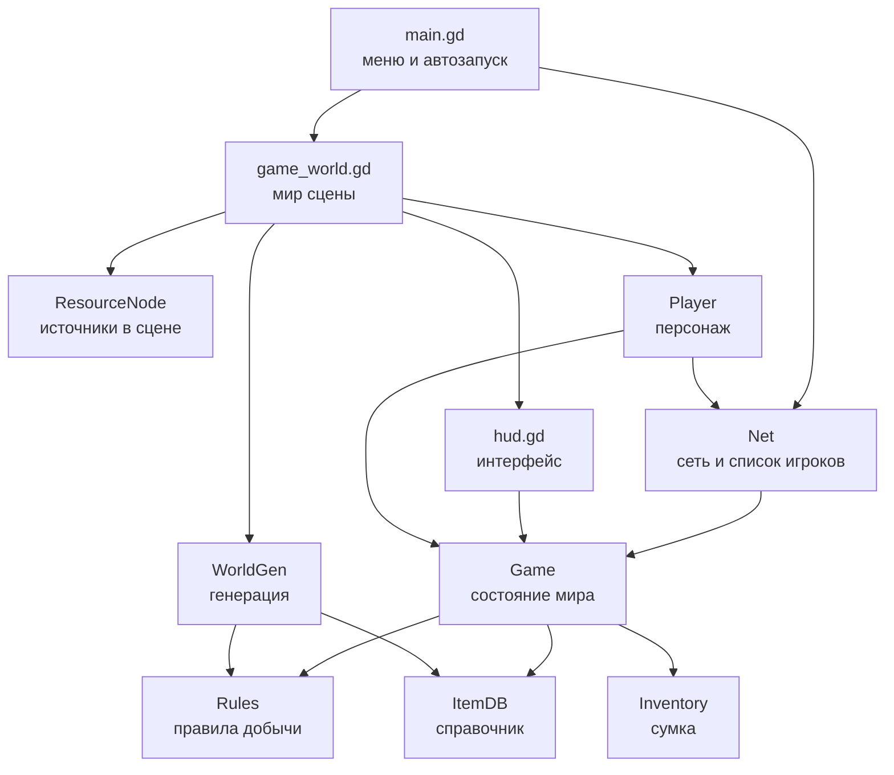
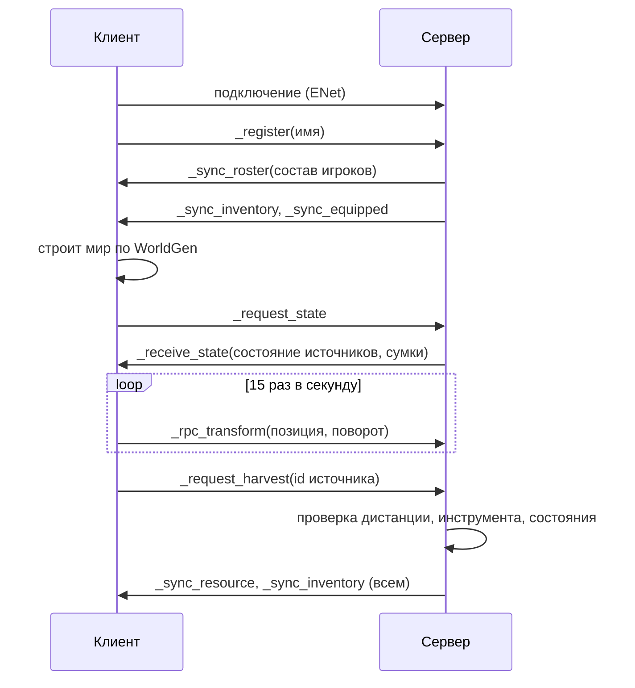

# Архитектура

## Принцип

Ядро отдельно, модули отдельно. Ядро это чистые данные и правила: справочник
предметов, сумка, правила добычи, генерация мира. У ядра нет ни сцен, ни сети,
поэтому его можно прогнать тестом в headless-режиме. Модули (сеть, мир,
персонаж, интерфейс) знают про ядро, ядро про них не знает.

## Слой за слоем



## Три автозагрузки

| Имя | Файл | Ответственность |
| --- | --- | --- |
| Controls | scripts/core/controls.gd | карта управления, поднимается кодом |
| Net | scripts/net/net.gd | ENet, состав игроков, обмен позициями |
| Game | scripts/core/game.gd | авторитетное состояние мира и инвентарей |

Порядок автозагрузки важен: Controls, Net, Game. Net не знает про ресурсы,
Game не знает про сокеты. Связь только через сигналы и вызовы.

## Почему мир генерируется локально

`WorldGen.build()` работает на одном сиде и не использует ничего, кроме
математики, поэтому у сервера и у клиента получается одна и та же карта:
81 источник, одинаковые позиции, одинаковые идентификаторы. По сети едет
только состояние источников (сколько ударов осталось, жив ли, когда
возродится), а не геометрия. Это экономит трафик и убирает целый класс
расхождений.

Проверяется тестом: две генерации подряд дают одинаковый список.

## Поток данных



## Контракты состояния

Состояние источника, ключ в `Game.resources` это номер из генератора:

```
{
  "type": "tree" | "stone" | "ore",
  "hits": int,          # сколько ударов осталось
  "alive": bool,        # можно ли добывать
  "respawn_at": float,  # секунды от старта процесса, 0 если источник жив
  "position": Vector3   # нужна серверу для проверки дистанции
}
```

Сумка по сети едет словарём `{"wood": 3, "axe": 1}` и на приёмной стороне
превращается в `Inventory` через `Inventory.from_dict`.

Предмет описан в `ItemDB.ITEMS`: имя, вид (tool или material), тег
инструмента, предел стака, цвет для интерфейса.

Правило добычи описано в `Rules.RESOURCE_SPECS`: нужный инструмент, какой
предмет падает, сколько ударов, время возрождения.

## Зоны

`WorldGen.zone_at(position)` возвращает имя зоны. Порядок проверок важен:
сначала шахта (внутри радиуса горы), потом каменоломня (кольцо вокруг горы),
потом лес, потом лагерь, иначе поляна. Зона не влияет на правила, это
подсказка игроку.

## Где границы

- Позиция персонажа: авторитет у клиента, сервер только слушает и проверяет
  дистанцию при добыче. Для честной игры в будущем позицию надо считать на
  сервере, это записано в ROADMAP.
- Добыча, сумка, руки: авторитет у сервера. Клиент не может начислить себе
  предмет, он может только попросить.
- Мир: общий код генерации на обеих сторонах, состояние источников с сервера.

## Сцены

`scenes/main.tscn` это один узел со скриптом, `scenes/world.tscn` тоже.
Мир, персонаж и интерфейс собираются кодом из примитивов. Так проект не
зависит от импортированных моделей и одинаково работает на чистой машине.
Когда появятся настоящие модели и анимации, персонажа и источники стоит
перевести в обычные сцены с ресурсами.
